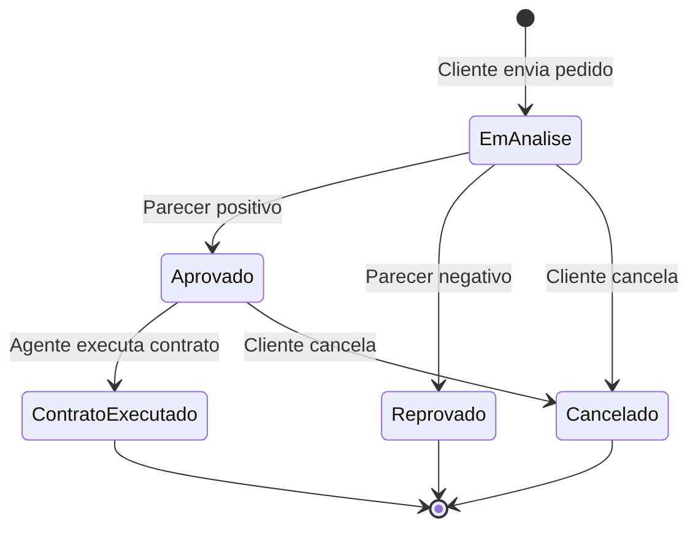
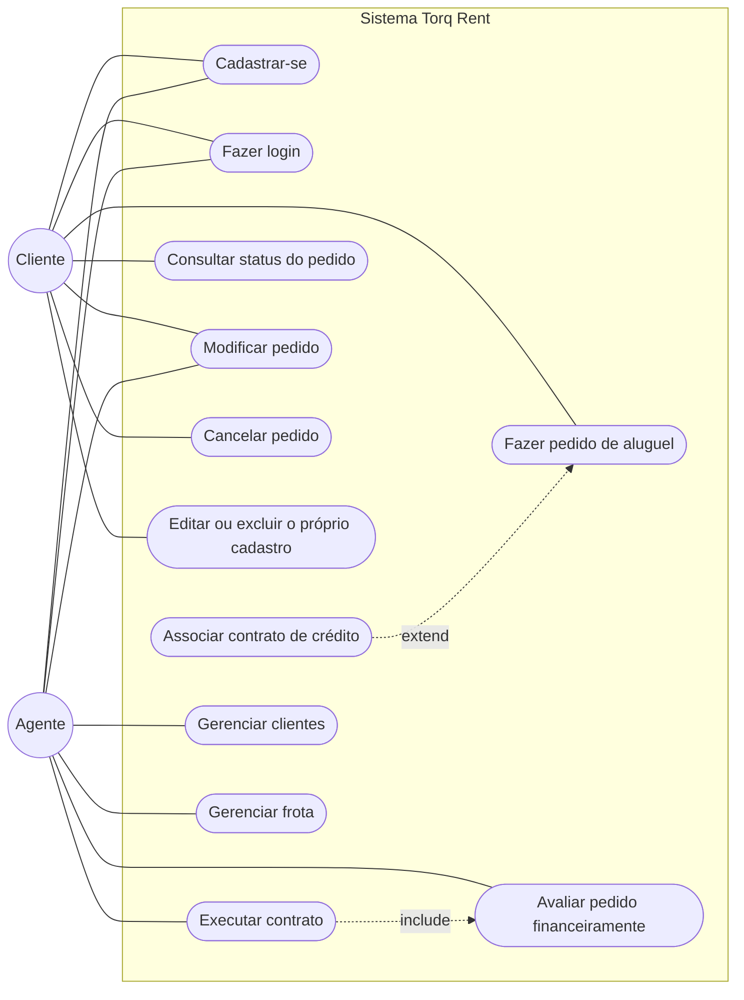
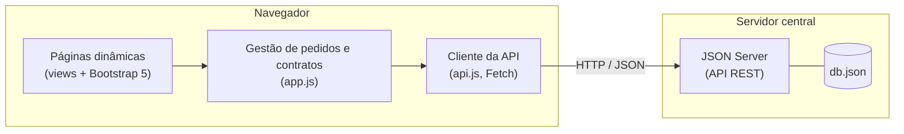
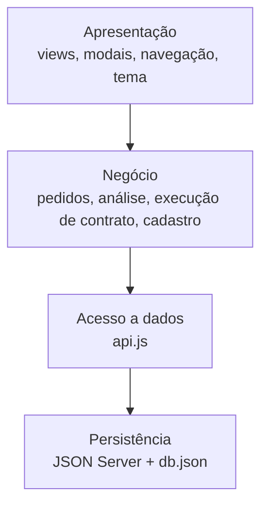
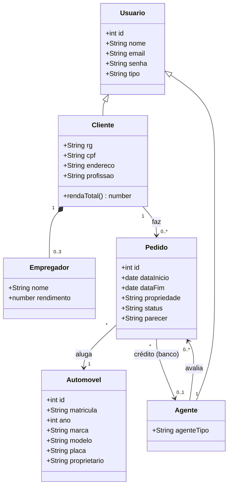

# - Torq Rent -
 
> **Sistema web para gestão de aluguéis de automóveis:** clientes fazem, modificam, consultam e cancelam pedidos pela Internet, e agentes (empresas e bancos) avaliam o lado financeiro e executam o contrato.
>
> **Logo:** um escudo hexagonal robusto (solidez) cortado por duas lâminas inclinadas para frente (velocidade), em teal `#1B998B` e vermelho `#DF2935`.
 
---
 
## Status do Projeto
 


 
**Situação:** protótipo funcional (laboratório de Desenvolvimento de Interfaces Web). Cobre cadastro, CRUD de cliente e o ciclo completo do pedido de aluguel.
 
---
 
## Caminhamento
 
- [Sobre o Projeto](#sobre-o-projeto)
- [Funcionalidades Principais](#funcionalidades-principais)
- [Tecnologias Utilizadas](#tecnologias-utilizadas)
- [Arquitetura](#arquitetura)
- [Histórias do Usuário](#histórias-do-usuário)
- [Como Executar a Aplicação](#como-executar-a-aplicação)
- [Documentações utilizadas](#documentações-utilizadas)
- [Autor](#autor)
---
 
## Sobre o Projeto
 
Locadoras costumam atender pedidos por telefone e balcão, o que dificulta acompanhar o status de cada pedido e a análise de crédito. A **Torq Rent** centraliza esse fluxo na web.
 
- **Problema:** pedidos de aluguel, análise financeira e execução de contrato espalhados em canais diferentes.
- **Solução:** um sistema em que o cliente registra e acompanha o pedido, e o agente analisa renda e crédito antes de executar o contrato.
- **Contexto:** projeto acadêmico, com modelagem UML (casos de uso, classes, pacotes e componentes) e protótipo implementado.
- **Regras do domínio:**
  - O sistema só pode ser usado após cadastro prévio.
  - O contratante tem RG, CPF, nome, endereço, profissão e até **3** entidades empregadoras com rendimentos.
  - O automóvel (matrícula, ano, marca, modelo e placa) pode ser registrado como propriedade do **cliente, empresa ou banco**, conforme o contrato.
  - O aluguel pode estar associado a um **contrato de crédito** concedido por um banco agente.
---
 
## Funcionalidades Principais
 
- **Cadastro e login:** contas de cliente e de agente (empresa ou banco).
- **Pedidos (cliente):** criar, modificar (enquanto "Em análise"), consultar o status e cancelar.
- **Análise financeira (agente):** vê a renda total do cliente e registra parecer positivo ou negativo com justificativa.
- **Execução de contrato:** pedidos aprovados viram contrato e o automóvel passa a constar com a propriedade definida.
- **Crédito:** associação opcional do pedido a um banco.
- **CRUD de cliente:** cadastro, edição e exclusão (pelo próprio cliente ou por agentes).
- **Frota:** agentes cadastram e excluem automóveis.
- **Catálogo (antes do CRUD):** 16 modelos reais de veículos com fotografias reais, estado (novo, seminovo ou usado), quilometragem e localização, em lista no estilo de portais de aluguel: busca por local de retirada e datas, filtros laterais (estado, categoria, marca, preço e quilometragem) e ordenação. Os 16 veículos também ficam registrados na coleção `automoveis`; o botão "Adicionar à frota" garante o vínculo no JSON e abre diretamente a tela de frota/CRUD. "Fazer pedido" abre o pedido já preenchido.
- **Perfil:** caixas separadas com identificação, resumo, informações básicas e fontes de renda.
- **Meu histórico (menu superior):** **biblioteca** com os carros de contratos executados e linha do tempo de todos os pedidos.
- **Tema claro e escuro:** alternância na barra de navegação, com a preferência salva no navegador.
**Fluxo de status do pedido**
 

 
---
 
## Tecnologias Utilizadas
 
### Front-end
 
- **Estrutura e lógica:** HTML5, CSS3 e JavaScript (ES6+), sem framework.
- **Interface:** [Bootstrap 5.3](https://getbootstrap.com/) (via CDN), personalizado com as cores e a tipografia (Outfit) da marca.
- **Consumo da API:** Fetch API.
### Back-end (simulado)
 
- **API REST e persistência:** [JSON Server 0.17.4](https://github.com/typicode/json-server), a partir do arquivo `db.json`.
- **Catálogo:** coleção `catalogo` do próprio `db.json`, servida pelo mesmo JSON Server (sem rotas extras). As fotos reais ficam em `fotoUri` e são hospedadas no Wikimedia Commons; `fotoFonte` aponta para a página de origem com autor e licença. `public/js/fotos.js` continua disponível apenas como fallback quando um registro não tiver foto. Os créditos estão em `docs/creditos-imagens.md`.
- **Runtime:** Node.js v18 ou superior.
> **Nota:** não há banco de dados real, autenticação com token nem containers. A senha fica em texto puro no `db.json` porque o objetivo é simular o servidor.
 
---
 
## Arquitetura
 
O sistema se divide em dois subsistemas, como pede o enunciado, dentro de uma arquitetura cliente-servidor: o navegador (clientes e agentes) fala com o servidor central, que expõe a API REST.
 
- **Subsistema de gestão de pedidos e contratos:** regras de negócio e acesso aos dados (`api.js` e as funções de pedido, parecer e execução em `app.js`).
- **Subsistema de construção dinâmica das páginas:** funções `view*` de `app.js`, que montam o HTML com Bootstrap.
### Diagrama de casos de uso
 

 
> Cliente e Agente são os dois atores. `Associar contrato de crédito` é opcional dentro de `Fazer pedido de aluguel` (extend). `Executar contrato` só é possível depois de um pedido avaliado e aprovado (include).
 
### Diagrama de componentes
 

 
### Diagrama de pacotes (visão lógica)
 

 
### Diagrama de classes
 

 
> No `db.json`, `Cliente` e `Agente` ficam na coleção `usuarios`, diferenciados pelo campo `tipo`. `Empregador` é um array embutido no cliente.
 
---
 
## Histórias do Usuário
 
### Cliente
 
| ID | História | Critérios de aceite |
|:--|:--|:--|
| US01 | Como **cliente**, quero me cadastrar informando meus dados e até 3 empregadores com rendimentos, para poder usar o sistema. | Nome, e-mail e senha são obrigatórios. E-mail repetido é recusado. No máximo 3 empregadores. |
| US02 | Como **cliente**, quero entrar com e-mail e senha, para acessar meus pedidos. | Credenciais erradas mostram mensagem de erro. Sem login, nenhuma tela é acessível. |
| US03 | Como **cliente**, quero fazer um pedido de aluguel escolhendo o automóvel e o período, para reservar o carro. | A devolução deve ser depois da retirada. O pedido nasce com status "Em análise". |
| US04 | Como **cliente**, quero indicar de quem o automóvel ficará registrado (cliente, empresa ou banco), para refletir o tipo de contrato. | O pedido guarda a propriedade escolhida. |
| US05 | Como **cliente**, quero associar um contrato de crédito de um banco ao pedido, para financiar o aluguel. | Campo opcional. Só lista agentes do tipo banco. |
| US06 | Como **cliente**, quero consultar meus pedidos e o status de cada um, para acompanhar a análise. | A lista mostra automóvel, período, propriedade, status e parecer. Só aparecem os meus pedidos. |
| US07 | Como **cliente**, quero modificar um pedido que ainda está em análise, para corrigir datas ou o automóvel. | A ação só aparece com status "Em análise". |
| US08 | Como **cliente**, quero cancelar um pedido, para desistir do aluguel. | Pede confirmação. Pedido reprovado, cancelado ou com contrato executado não pode ser cancelado. |
| US09 | Como **cliente**, quero editar ou excluir meu cadastro, para manter meus dados corretos ou sair do sistema. | A exclusão pede confirmação e remove também os meus pedidos. |
| US18 | Como **cliente**, quero ver os carros do catálogo com foto, estado, quilometragem e localização, para escolher antes de pedir. | Busca por local e datas e filtros laterais. "Fazer pedido" abre o formulário com o carro e as datas escolhidos. |
| US19 | Como **cliente**, quero uma biblioteca com os carros que já aluguei e o histórico dos meus pedidos, para consultar e repetir um aluguel. | A biblioteca lista carros com contrato executado. O histórico mostra todos os status. |
 
### Agente (empresa ou banco)
 
| ID | História | Critérios de aceite |
|:--|:--|:--|
| US10 | Como **agente**, quero ver todos os pedidos, para organizar a análise. | A lista mostra o nome do cliente, o automóvel, o período e o status. |
| US11 | Como **agente**, quero ver a renda total e os empregadores do cliente, para avaliar o pedido financeiramente. | A tela de análise mostra cada rendimento e o total. |
| US12 | Como **agente**, quero registrar um parecer positivo ou negativo com justificativa, para decidir o pedido. | A justificativa é obrigatória. O status muda para "Aprovado" ou "Reprovado". |
| US13 | Como **agente**, quero modificar um pedido ainda aberto, para ajustar condições como o crédito. | Não permite modificar pedidos cancelados, reprovados ou com contrato executado. |
| US14 | Como **agente**, quero executar o contrato de um pedido aprovado, para concluir o aluguel. | Só aparece com status "Aprovado". O automóvel passa a constar com a propriedade definida no pedido. |
| US15 | Como **agente**, quero consultar, editar e excluir clientes, para manter a base de cadastro. | A tela de clientes é exclusiva de agentes. |
| US16 | Como **agente**, quero cadastrar e excluir automóveis da frota, para manter os carros disponíveis. | Registra matrícula, ano, marca, modelo e placa. Não exclui automóvel com pedidos associados. |
| US17 | Como **agente**, quero adicionar um carro do catálogo à frota, para não cadastrá-lo à mão. | O botão "Adicionar à frota" não duplica carros já existentes. |
 
---
 
## Como Executar a Aplicação
 
**Pré-requisitos:** Node.js v18 ou superior (o npm já vem junto).
 
```bash
git clone <https://github.com/Deutzan/Lab2.git>
cd torq-rent
npm install
npm start
```
 
Abra **http://localhost:3000**. O mesmo processo serve a interface (`public/`) e a API REST.
 
**Contas de teste** (senha `123`):
 
| Perfil | E-mail |
|:--|:--|
| Cliente | `cliente@torq.com` |
| Agente (empresa) | `empresa@torq.com` |
| Agente (banco) | `banco@torq.com` |
 
**Endpoints principais**
 
| Recurso | Rotas |
|:--|:--|
| Usuários | `GET/POST /usuarios`, `GET/PUT/PATCH/DELETE /usuarios/:id` |
| Automóveis | `GET/POST /automoveis`, `GET/PATCH/DELETE /automoveis/:id` |
| Pedidos | `GET/POST /pedidos`, `GET/PATCH/DELETE /pedidos/:id` (filtro: `?usuarioId=1`) |
| Catálogo | `GET /catalogo` (filtros nativos do JSON Server, como `?estado=Novo&cidade=Contagem`), `GET /catalogo/:id` |
 
Para voltar aos dados iniciais, restaure o `db.json` com `git checkout db.json`.
 
---
 
## Documentações utilizadas
 
- [Bootstrap 5.3](https://getbootstrap.com/docs/5.3/getting-started/introduction/)
- [JSON Server](https://github.com/typicode/json-server/tree/v0.17.4)
- [Fetch API (MDN)](https://developer.mozilla.org/pt-BR/docs/Web/API/Fetch_API)
- [Mermaid (diagramas em Markdown)](https://mermaid.js.org/)
- [Conventional Commits](https://www.conventionalcommits.org/pt-br/v1.0.0/)
---


## Autor

| Nome | GitHub | LinkedIn | E-mail |
|:--|:--|:--|:--|
| Luis Felipe Dias de Almeida | [@Deutzan](https://github.com/Deutzan) | [perfil](https://www.linkedin.com/in/lu%C3%ADs-felipe-dias-3634a1388) | luisdias29agosto@gmail.com |
 
---
